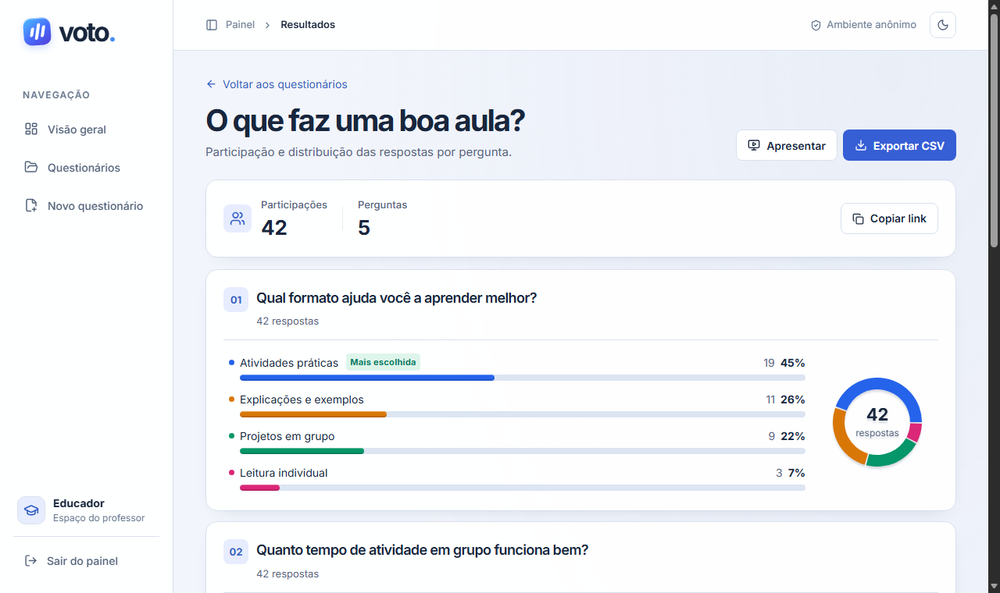
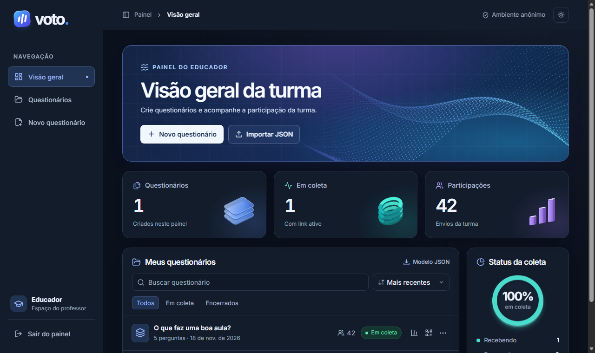
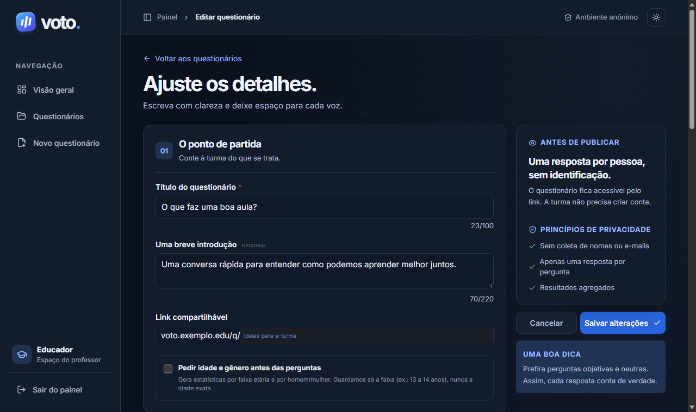
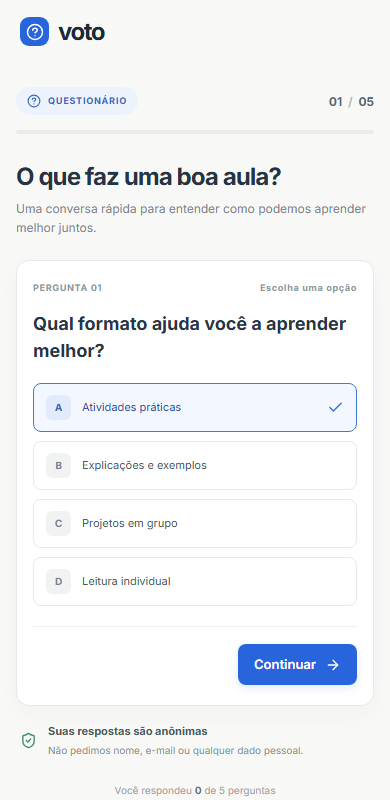
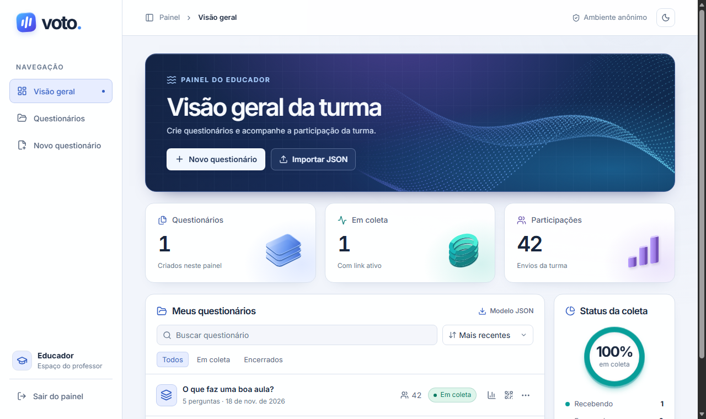
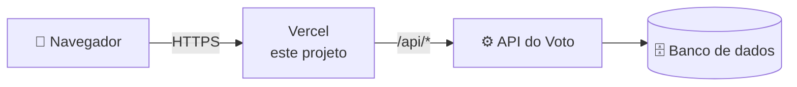

<div align="center">


# 🗳️ Voto

### Pergunte. Escute. Sem ninguém precisar se identificar.

Questionários **anônimos** para sala de aula: o professor cria as perguntas, a turma responde pelo celular, por link ou QR Code, e os resultados aparecem em gráficos.



</div>

> **O Voto não é uma urna eletrônica.** Ele serve para coletar opiniões e feedback da turma de forma anônima. Não há eleição, candidatos nem apuração oficial. As imagens deste README mostram um questionário fictício, sem nenhum dado real.

---

## 🌱 A ideia

Quando o professor pergunta "alguém tem dúvida?", ninguém levanta a mão, mas todo mundo tem. O Voto resolve isso: o professor publica um questionário, a turma responde **sem cadastro e sem dar o nome**, e o professor vê o resultado consolidado.

## 🧭 Como funciona

| | Quem faz | O que acontece |
|:-:|---|---|
| **1** | 👩‍🏫 **Professor** | Entra no painel, escreve as perguntas e as alternativas (ou importa de um arquivo `.json`). |
| **2** | 🧑‍🎓 **Alunos** | Abrem o **link** ou leem o **QR Code** com o celular e respondem, uma pergunta por vez. |
| **3** | 📊 **Todos** | O professor vê os resultados em gráficos, projeta em **modo apresentação** e, se quiser, baixa um **CSV**. |

## 📸 Telas

**Painel do professor.** Visão geral com questionários, participações e status da coleta.



**Editor.** Título, introdução, link compartilhável, pergunta de idade e gênero (opcional) e as perguntas.



**Tela do aluno (celular).** Uma pergunta por vez, com barra de progresso e aviso de anonimato.



**Tema claro.** O painel tem tema claro e escuro.



## 🎁 O que dá para fazer

**Para quem ensina**

- Criar, editar, ativar/encerrar e excluir questionários
- Importar perguntas de um arquivo `.json` (há um **modelo** para baixar)
- Compartilhar por **link** ou **QR Code**
- Ver os resultados por pergunta: total de respostas, porcentagens, "mais escolhida" e gráfico
- Ver as respostas por **faixa de idade** e por **homem/mulher** (opcional, só se você ligar)
- **Modo apresentação**: tela cheia com QR Code e resultados, navegação pelo teclado
- Exportar tudo em **CSV**
- Escolher o tema **claro** ou **escuro**

**Para quem responde**

- Tela feita para o celular, uma pergunta por vez
- Sem nome, e-mail ou qualquer dado pessoal

## 🔒 E o anonimato? É de verdade?

| ✅ O Voto guarda | 🚫 O Voto NÃO guarda |
|---|---|
| Qual alternativa foi escolhida | Seu nome ou e-mail |
| A hora cheia do envio (ex.: "14h") | O minuto exato em que você respondeu |
| Se o professor pedir: a **faixa de idade** (ex.: "13 a 14 anos") e **homem/mulher** | Sua idade exata ou qualquer "crachá" que ligue a resposta a você |

> ⚠️ Em uma turma bem pequena, "faixa de idade + gênero" pode deixar a pessoa fácil de adivinhar. Por isso esse pedido é **opcional** e só aparece quando o professor liga.

## ❓ Perguntas que todo mundo faz

<details>
<summary><b>O aluno precisa criar conta?</b></summary>

Não. Basta abrir o link. Só o professor entra com usuário e senha, para cuidar dos questionários.
</details>

<details>
<summary><b>Posso responder duas vezes?</b></summary>

O aparelho lembra que você já respondeu e avisa "Você já participou", para evitar reenvio sem querer. Esse lembrete fica só no seu celular; ninguém recebe essa informação.
</details>

<details>
<summary><b>Como ligo a coleta de idade e gênero?</b></summary>

No editor do questionário, marque **"Pedir idade e gênero antes das perguntas"**. Se não marcar, nada disso é perguntado.
</details>

<details>
<summary><b>Como importo um questionário pronto?</b></summary>

No painel, clique em **Importar JSON** e escolha um arquivo `.json`. Clique em **Modelo JSON** para baixar um exemplo e trocar só os textos.
</details>

<details>
<summary><b>Dá para ver os resultados no Excel?</b></summary>

Dá. Na tela de resultados, clique em **Exportar CSV**. O arquivo abre no Excel ou no Google Planilhas.
</details>

## 🛠️ Para quem é da tecnologia

**Como as peças se encaixam**



- Este repositório é o **front-end**: React 18 + Vite + TypeScript + Tailwind CSS 4.
- A **API** (Node + Fastify + Prisma + PostgreSQL) e o banco rodam em uma VPS e **não estão neste repositório**. A Vercel repassa as chamadas `/api/*` para lá (veja o [`vercel.json`](vercel.json)).
- Principais bibliotecas: React Router, TanStack Query, React Hook Form + Zod, Recharts, qrcode.react, Sonner e Lucide.

### Rodar no seu computador

Requisitos: Node.js 20 ou mais novo.

```bash
npm install
npm run dev          # http://localhost:5173
```

Sem nenhuma variável de ambiente, o app abre em **modo demonstração**: os dados são de mentirinha e ficam só no navegador. Entre em `/admin/login` com **usuário `professor` e senha `sala123`**. O questionário de exemplo, "O que faz uma boa aula?", tem 42 respostas fictícias e é o mesmo das capturas de tela.

Para usar a API de verdade, desligue o modo demonstração e aponte para a API (por padrão `http://127.0.0.1:3000`):

```bash
VITE_USE_MOCK=false npm run dev                                  # API em http://127.0.0.1:3000
VITE_USE_MOCK=false VITE_PROXY_TARGET=http://127.0.0.1:4000 npm run dev   # API em outro endereço
```

| Comando | Para quê |
|---|---|
| `npm run dev` | Abrir o app para desenvolver (porta 5173) |
| `npm test` | Rodar os testes (Vitest; 10 testes) |
| `npm run build` | Conferir os tipos e gerar `dist/` |
| `npm run preview` | Servir o build localmente |

**Variáveis** (veja [`.env.example`](.env.example)): `VITE_USE_MOCK` (`false` em produção), `VITE_API_URL` (opcional, só se a API estiver em outro domínio) e `VITE_PROXY_TARGET` (destino do proxy `/api` no `npm run dev`). Elas são públicas: nunca coloque segredos nelas.

**Formato do arquivo de importação**

```json
{
  "titulo": "Como foi a aula de hoje?",
  "descricao": "Leva 1 minutinho!",
  "coletaPerfil": false,
  "perguntas": [
    { "enunciado": "O que você achou?", "opcoes": ["Gostei muito", "Mais ou menos", "Não gostei"] }
  ]
}
```

**Publicar:** cada `git push` na branch `main` publica na Vercel.

**Pastas principais**

```
src/pages/        as telas (painel, editor, resultados, apresentação, questionário do aluno)
src/components/   peças reutilizáveis (menu, botão de tema...)
src/lib/          API, importação, CSV, tema
docs/screenshots/ capturas deste README (questionário fictício)
public/           ícone e o efeito do aviso "salvo"
```

## 💙 Agradecimentos

- O aviso animado de "salvo" é do [Sakuga VFX](https://sakuga-vfx.vercel.app) ✨
- Letras [Inter](https://rsms.me/inter/), ícones [Lucide](https://lucide.dev) e gráficos [Recharts](https://recharts.org)
