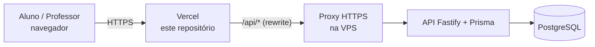

<div align="center">


# Voto

**Questionários anônimos para uma sala de aula mais participativa.**

O professor cria, compartilha por link ou QR Code e acompanha os resultados em tempo real.
O aluno responde pelo celular, sem conta, sem nome e sem e-mail.

[](https://react.dev)
[](https://vite.dev)
[](https://www.typescriptlang.org)
[](https://vercel.com)
[](#-privacidade-e-anonimato)

[**Ver o app**](https://questionario-anonimo-front.vercel.app/admin) · [Funcionalidades](#-funcionalidades) · [Como rodar](#-como-rodar) · [Arquitetura](#-arquitetura)

</div>

---

## ✨ Funcionalidades

| Para o professor | Para o aluno |
|---|---|
| 📊 Painel com indicadores, busca e filtros | 📱 Formulário pensado para o celular |
| ✏️ Criar e editar questionários | 🔗 Acesso por link ou QR Code |
| 📥 Importar questionário de um arquivo JSON | 🚫 Sem cadastro, nome ou e-mail |
| 🔗 Compartilhar por link e QR Code | ✅ Uma pergunta por vez, com progresso |
| 📈 Resultados com gráficos e percentuais | 🌗 Tema claro e escuro |
| 👥 Quebra por **gênero e faixa etária** (opcional) | 🔒 Dados enviados sem identificação |
| 🖥️ Modo apresentação para projetar na sala | |
| 📄 Exportar resultados em CSV | |

Também: tema claro/escuro, tela de carregamento, ícone do app e um aviso de "salvo" com efeito (Sakuga toast).

## 🔒 Privacidade e anonimato

- O formulário **não pede** nome, e-mail nem qualquer identificador; não há analytics, pixel nem serviço de terceiros.
- No servidor, a resposta guarda só **pergunta, alternativa e a hora cheia** (sem IP, sem user-agent, sem ID de participante).
- Quando o professor liga **"Pedir idade e gênero"**, o aluno informa os dois antes das perguntas, mas o servidor grava apenas a **faixa etária** (nunca a idade exata) e o gênero. Em turmas muito pequenas, faixa + gênero podem apontar para uma pessoa: use com isso em mente.
- O navegador guarda apenas um marcador local de "já respondi" para evitar reenvio acidental. Ele não é enviado ao servidor.

## 🏗️ Arquitetura



- **Front-end (este repositório):** SPA em React + Vite, publicada na Vercel.
- **`/api/*`:** a Vercel repassa as chamadas para a API (rewrite em [`vercel.json`](vercel.json)). Para o navegador, tudo é o mesmo domínio, então o cookie de sessão (`HttpOnly`, `Secure`, `SameSite=Strict`) funciona.
- **API e banco:** projeto separado (Fastify, Prisma e PostgreSQL), hospedado em uma VPS.

## 🚀 Como rodar

Pré-requisito: Node.js 20+.

```bash
npm install
npm run dev        # http://localhost:5173
```

Sem a API, rode em **modo demonstração** (dados fictícios no navegador):

```bash
VITE_USE_MOCK=true npm run dev      # login de demonstração: professor / sala123
```

Com a API local, o Vite encaminha `/api` para `http://127.0.0.1:3000`.

| Comando | O que faz |
|---|---|
| `npm run dev` | Servidor de desenvolvimento |
| `npm test` | Testes (Vitest) |
| `npm run build` | Checagem de tipos + build de produção em `dist/` |
| `npm run preview` | Serve o build localmente |

## ⚙️ Variáveis de ambiente

Veja [`.env.example`](.env.example).

| Variável | Uso |
|---|---|
| `VITE_USE_MOCK` | `false` em produção (sempre usa a API). `true` ativa o modo demonstração. |
| `VITE_API_URL` | Opcional: só se a API estiver em outro domínio. |

> Variáveis `VITE_*` são públicas. Nunca coloque segredos nelas.

## 📥 Importar um questionário

No painel, **Importar** aceita um arquivo JSON (o botão **Modelo** baixa um exemplo):

```json
{
  "titulo": "Título do questionário",
  "descricao": "Texto opcional de introdução",
  "coletaPerfil": false,
  "perguntas": [
    { "enunciado": "Primeira pergunta?", "opcoes": ["Opção A", "Opção B", "Opção C"] }
  ]
}
```

## ☁️ Publicação (Vercel)

Cada `git push` na `main` publica automaticamente. O [`vercel.json`](vercel.json) define o build (`VITE_USE_MOCK=false`), o fallback da SPA, os cabeçalhos de segurança e o rewrite de `/api/*`.

## 🧱 Estrutura

```
src/
├─ pages/        telas (painel, editor, resultados, apresentação, quiz do aluno)
├─ components/   layout, diálogos, botão de tema
├─ lib/          API, importação, CSV, percentuais, tema
└─ types/        tipos compartilhados
public/          ícone e toast.js (Sakuga toast, sem alterações)
```

## 🙏 Créditos

- Aviso de "salvo" com efeito: [Sakuga VFX](https://sakuga-vfx.vercel.app).
- Fonte [Inter](https://rsms.me/inter/), ícones [Lucide](https://lucide.dev), gráficos [Recharts](https://recharts.org).
