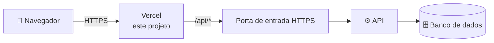

<div align="center">


# 🗳️ Voto

### Pergunte. Escute. Sem ninguém precisar se identificar.

Um jeito simples de a turma dizer **o que pensa de verdade**, sem vergonha, sem cadastro e sem medo de errar.

[**👉 Abrir o Voto**](https://questionario-anonimo-front.vercel.app/admin)

</div>

---

## 🌱 A ideia

Sabe quando o professor pergunta "alguém tem dúvida?" e ninguém levanta a mão, mas todo mundo tem?

O Voto resolve isso. O professor faz as perguntas, a turma responde **pelo celular, em segundos**, e ninguém sabe quem respondeu o quê. Quando todo mundo termina, o professor vê o resultado em gráficos coloridos. 🎨

> 💬 *"Quem não fala em voz alta costuma ter muito a dizer. O Voto dá a essa pessoa um lugar seguro para falar."*

## 🧭 Como funciona (em 3 passos)

| | Quem faz | O que acontece |
|:-:|---|---|
| **1️⃣** | 👩‍🏫 **Professor** | Escreve as perguntas e as alternativas (ou importa de um arquivo pronto). |
| **2️⃣** | 🧑‍🎓 **Alunos** | Abrem o **link** ou leem o **QR Code** com o celular e respondem, uma pergunta por vez. |
| **3️⃣** | 📊 **Todos** | O professor vê os resultados, projeta na sala e, se quiser, baixa uma planilha. |

Pronto! Sem cadastro, sem senha para o aluno, sem papel. ✨

## 🎁 O que dá para fazer

**Para quem ensina** 👩‍🏫

- ✏️ Criar e editar questionários do seu jeito
- 📥 Importar perguntas de um arquivo, para não digitar tudo de novo
- 🔗 Compartilhar por **link** ou **QR Code** (é só mostrar na tela!)
- 📈 Ver os resultados em gráficos e porcentagens
- 👥 Ver as respostas separadas por **idade** e por **homem/mulher** (se você quiser)
- 🖥️ **Modo apresentação**: resultados em tela cheia para projetar na sala
- 📄 Baixar tudo em uma planilha (CSV) que abre no Excel
- 🌗 Escolher entre o tema **claro** e o **escuro**

**Para quem responde** 🧑‍🎓

- 📱 Tela feita para o celular, fácil de usar com o dedo
- 👣 Uma pergunta por vez, com uma barrinha mostrando o quanto falta
- 🙈 Sem dar nome, e-mail ou qualquer dado pessoal

## 🔒 E o anonimato? É de verdade?

Sim! Veja o que o Voto **faz** e o que ele **não faz**:

| ✅ O Voto guarda | 🚫 O Voto NÃO guarda |
|---|---|
| Qual alternativa foi escolhida | Seu nome ou e-mail |
| A hora cheia do envio (ex.: "14h") | O minuto exato em que você respondeu |
| Se o professor pedir: a **faixa de idade** (ex.: "13 a 14 anos") e **homem/mulher** | Sua idade exata, seu IP ou qualquer "crachá" que ligue a resposta a você |

> ⚠️ **Um cuidado importante:** em uma turma bem pequena, "faixa de idade + gênero" pode deixar a pessoa fácil de adivinhar (se só existe uma menina de 15 anos na sala, por exemplo). Por isso, esse pedido é **opcional** e só aparece quando o professor ligar.

## ❓ Perguntas que todo mundo faz

<details>
<summary><b>O aluno precisa criar conta?</b></summary>

Não! Basta abrir o link. Só o professor entra com usuário e senha, para cuidar dos questionários.
</details>

<details>
<summary><b>Posso responder duas vezes?</b></summary>

O aparelho lembra que você já respondeu e avisa "Você já participou", para evitar reenvio sem querer. Esse lembrete fica só no seu celular; ninguém recebe essa informação.
</details>

<details>
<summary><b>Como ligo a coleta de idade e gênero?</b></summary>

No editor do questionário, marque a caixinha **"Pedir idade e gênero antes das perguntas"**. Se não marcar, nada disso é perguntado.
</details>

<details>
<summary><b>Como importo um questionário pronto?</b></summary>

No painel, clique em **Importar** e escolha um arquivo `.json`. Não sabe como é o arquivo? Clique em **Modelo**: ele baixa um exemplo para você só trocar os textos.
</details>

<details>
<summary><b>Dá para ver os resultados no Excel?</b></summary>

Dá! Na tela de resultados, clique em **Exportar CSV**. O arquivo abre no Excel ou no Google Planilhas.
</details>

## 🛠️ Para quem é da tecnologia

<details>
<summary><b>Clique aqui para ver a parte técnica</b></summary>

<br/>

**Como as peças se encaixam**



- Este repositório é o **front-end** (a parte que a gente vê): React + Vite + TypeScript.
- A **API** e o **banco** ficam em outro lugar (uma VPS). A Vercel repassa as chamadas de `/api/*` para lá (veja o [`vercel.json`](vercel.json)), então, para o navegador, tudo parece um site só.

**Rodar no seu computador** (precisa do Node.js 20+)

```bash
npm install
npm run dev          # abre em http://localhost:5173
```

Quer só espiar, sem API? Use o **modo demonstração** (dados de mentirinha, só no navegador):

```bash
VITE_USE_MOCK=true npm run dev     # login: professor / sala123
```

| Comando | Para quê |
|---|---|
| `npm run dev` | Abrir o app para desenvolver |
| `npm test` | Rodar os testes |
| `npm run build` | Gerar a versão final (pasta `dist/`) |

**Variáveis** (veja [`.env.example`](.env.example)): `VITE_USE_MOCK` (use `false` em produção) e `VITE_API_URL` (opcional, só se a API estiver em outro endereço). Elas são públicas: nunca coloque segredos nelas.

**Formato do arquivo de importação**

```json
{
  "titulo": "Como foi a aula de hoje?",
  "descricao": "Leva 1 minutinho!",
  "coletaPerfil": false,
  "perguntas": [
    { "enunciado": "O que você achou?", "opcoes": ["Gostei muito", "Mais ou menos", "Não gostei"] }
  ]
}
```

**Publicar:** cada `git push` na branch `main` publica sozinho na Vercel.

**Pastas principais**

```
src/pages/        as telas (painel, editor, resultados, quiz do aluno...)
src/components/   peças reutilizáveis (menu, botão de tema...)
src/lib/          a "cozinha": API, importação, CSV, tema
public/           ícone e o efeito do aviso "salvo"
```

</details>

## 💙 Agradecimentos

- O aviso animado de "salvo" é do [Sakuga VFX](https://sakuga-vfx.vercel.app) ✨
- Letras [Inter](https://rsms.me/inter/), ícones [Lucide](https://lucide.dev) e gráficos [Recharts](https://recharts.org)

<div align="center">

Feito com carinho para salas de aula mais participativas. 🌈

</div>
